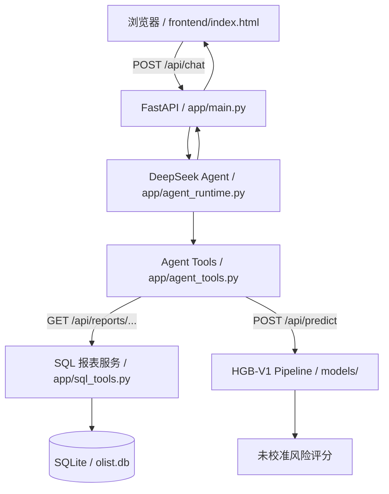

# DataPilot

**基于 Olist 历史电商数据的业务分析与订单延期风险评分 Agent**

DataPilot 是一个端到端的数据科学与 AI Agent 实践项目：将 Olist 原始 CSV 导入 SQLite，构建可复用的业务 SQL 报表，训练订单延期风险评分模型，并通过 FastAPI 将报表查询和模型推理封装为工具，由 DeepSeek 驱动的 Agent 根据自然语言问题选择调用。项目提供简洁的 Web 聊天界面、多轮对话上下文及自动化回归测试。

> **项目定位**：历史数据分析与技术演示，不是在线物流风控产品。模型输出是**未经概率校准的风险评分**，不能直接解释为真实延期概率，也不应用于生产业务决策。

## 当前版本：V2 本地 Text-to-SQL 工作台

> V2 已实现；以下原有 V1 章节保留作为项目历史基线，最新 V2 状态及局限以本节和 `docs/V2_RELEASE_NOTES.md` 为准。

- **V1**：`/` 对话页面，支持固定报表及已训练的 HGB 延期风险评分工具；预测分数未经概率校准。
- **V2**：`/v2` 单轮数据分析页面，调用 `POST /api/v2/query`，支持自然语言转 SQL、SQLite 只读安全执行、语义风险提示、结果表格和 SQL/Token/耗时展示。
- **权限与风险**：V2 默认关闭，启用后仅允许本机访问；仅授权部分 Olist 数据表。`no_known_risk` 不代表业务语义得到证明；无自动 SQL 修复、不支持 V2 多轮上下文。
- **本地启动**（先准备好数据、模型、`.env` 和依赖）：

  ```powershell
  $env:DATAPILOT_V2_ENABLED="1"
  python -m uvicorn app.main:app --host 127.0.0.1 --port 8000
  ```

  浏览器访问 `http://127.0.0.1:8000/v2`；V1 仍在 `http://127.0.0.1:8000/`。每次 V2 查询可能产生模型 API 费用。
- **当前综合回归**：2026-11-28 本地 `python -m pytest tests -q`：190 passed、48 subtests passed、17 条 LangSmith 弃用警告（非失败）。
- **研究结果**：Holdout 12 自动 4/8 SQL、人工审计 8/8 SQL；Hard8 自动 2/8 双数据库、后验人工审计 7/8；X08 原始执行超出 500 万 VM 指令预算，人工过滤下推候选在原预算内通过；X03 另有日期有效性边界失败。完整口径见 `docs/V2_RELEASE_NOTES.md`。
- **后续 V3**：将 V2 Text-to-SQL 与已有预测模型统一为多工具 Agent，增加多轮上下文和受控 SQL 自动修复（V2 未实现）。

## 1. 功能概览

- **业务数据分析**：查看订单状态、月度延期率、热销商品类别和客户州分布等预定义 SQL 报表。
- **机器学习推理**：根据购买月份、星期、商品条目数、商品金额及客户所在州，调用已保存的 HGB 分类器输出延期风险评分。
- **自然语言 Agent**：DeepSeek + LangChain/LangGraph，自动选择报表工具或预测工具；信息不足时要求用户补充。
- **Web 交互**：纯 HTML/CSS/JavaScript 页面，支持 Markdown 回答展示和基于会话 ID 的多轮聊天。
- **工程验证**：FastAPI 输入校验、只读 SQLite 查询、异常处理及 pytest 回归测试。

## 2. 系统架构



**主要技术栈**：Python、Pandas、SQLite、Scikit-learn、Joblib、FastAPI、Pydantic、LangChain、LangGraph、DeepSeek API、pytest、HTML/CSS/JavaScript。

## 3. 项目结构

```text
DataPilot/
├── app/
│   ├── main.py                    # FastAPI：Web、报表、预测、聊天
│   ├── agent_runtime.py           # 创建 DeepSeek Agent 与对话检查点
│   ├── agent_tools.py             # Agent 可调用的业务工具
│   └── sql_tools.py               # 受控只读 SQL 报表执行
├── frontend/
│   └── index.html                 # Web 聊天界面
├── scripts/
│   ├── config.py                  # 数据路径等配置
│   ├── 01_audit_raw.py            # 原始 CSV 审计
│   ├── 02_load_sqlite_fixed.py    # 导入 SQLite（实际使用版本）
│   ├── 03_quality_checks.py       # 数据质量检查
│   ├── 04_run_queries.py          # 执行 sql/queries 下的报表 SQL
│   ├── 05_check_features.py       # 模型特征检查
│   ├── 06_check_time_distribution.py
│   ├── 07_check_label_maturity.py
│   ├── 08_train_baseline.py       # Logistic Regression 基线
│   ├── 09_compare_features.py
│   ├── 10_compare_lr_v1_v2.py     # 特征消融与 log1p 对照
│   ├── 11_compare_tree_models.py  # HGB 对照实验
│   ├── 12_save_model.py           # 训练并保存 HGB-V1 Pipeline
│   └── 13_run_agent.py            # 命令行 Agent
├── sql/
│   ├── schema.sql
│   └── queries/                   # 业务指标、标签与特征 SQL
├── tests/
│   ├── test_api.py                # API / 模型 / 模拟 Agent 回归测试
│   └── test_sql_metrics.py        # SQL 指标测试
├── data/                           # 原始 CSV / 生成的 SQLite（通常不提交）
├── reports/                        # 审计报告与查询输出（部分自动生成）
├── models/                         # 训练后模型与元数据
├── .env.example
├── .gitignore
└── requirements.txt               # 项目直接依赖
```

项目还保留了 `README_FIRST_ROUND.md` 作为早期阶段练习说明。

## 4. 数据来源与处理

使用 **[Olist Brazilian E-Commerce Public Dataset](https://www.kaggle.com/datasets/olistbr/brazilian-ecommerce)** 的历史电商订单数据。项目导入九张原始数据表：`orders`、`order_items`、`order_payments`、`order_reviews`、`customers`、`products`、`sellers`、`geolocation` 和 `category_translation`。

本地实验数据规模：订单表 **99,441** 行；已交付订单 **96,478** 笔；其中具备延期标签所需日期的已交付订单 **96,470** 笔，延期 **6,534** 笔（约 **6.77%**）。统计口径和筛选条件以相应 SQL 文件为准。

**原始数据不随仓库提交。** 获取 Olist 数据集后，将九份原始 CSV 放入项目根目录的 `data/raw/`（已在独立克隆环境实际验证），保持原始文件名不变。具体文件与路径映射可查阅 `scripts/config.py`。

### 数据准备与离线重建

在项目根目录、依赖安装完成、CSV 放置正确后依次执行：

```powershell
python scripts/01_audit_raw.py
python scripts/02_load_sqlite_fixed.py
python scripts/03_quality_checks.py
python scripts/04_run_queries.py
```

`04_run_queries.py` 会执行 `sql/queries/` 目录中的 SQL，并输出查询结果到 `reports/sql/`。其中：

- `09_delivery_risk_labels.sql`：依据实际送达日期与预计送达日期生成延期标签。
- `11_order_features.sql`：生成五特征 V1 订单级训练数据。
- `12_order_features_v2.sql`：生成十特征 V2 订单级训练数据。

这部分生成物是模型训练与测试的先决条件。

## 5. 模型方法与实验结果

**预测目标**：判断已交付订单的实际送达日期是否晚于预计送达日期。该目标用于历史数据回顾性研究；预测输入不包含实际送达日期。

**HGB-V1 输入特征**：

| 字段 | 含义 |
|---|---|
| `purchase_month` | 购买月份（1–12） |
| `purchase_weekday` | 购买星期，SQLite `%w` 编码：0=周日，6=周六 |
| `item_count` | 订单商品条目数 |
| `item_value` | 商品金额之和（不含运费） |
| `customer_state` | 客户所在巴西州代码 |

**时间划分与标签成熟度**：训练使用 2018-05-01 前购买且在该日期前已送达的订单（**68,318** 条）；验证使用 2018 年 5–6 月购买且在 2018-07-01 前已送达的订单（**11,149** 条）。曾以 2018 年 7 月购买的 **6,156** 条订单进行回顾性测试；最终模型选择主要依据验证集。

| 模型 | 特征数 | Validation AP | Validation ROC-AUC |
|---|---:|---:|---:|
| Logistic Regression V1 | 5 | 0.0545 | **0.6163** |
| Logistic Regression V2 | 10 | 0.0525 | 0.6019 |
| HistGradientBoosting V1 | 5 | **0.0594** | 0.5593 |
| HistGradientBoosting V2 | 10 | 0.0567 | 0.5625 |

当前 API 暂时采用 **HGB-V1**，主要因为它在该验证集上的 AP 最高；它的整体排序能力仍然较弱。基线 LR-V1 的已观察测试集指标为 AP **0.0551**、ROC-AUC **0.5385**；**不能把这个测试结果冒充 HGB-V1 的测试结果**。

### 重新训练并保存模型

完成数据准备、生成特征 CSV 后运行：

```powershell
python scripts/12_save_model.py
```

预期生成 `models/delivery_risk_hgb_v1.joblib` 和 `models/metadata.json`。模型文件应仅从可信的本地构建流程中生成，不要加载来源不明的 Joblib 文件。

**已知限制**：已交付订单筛选与标签成熟度截止可能造成样本选择偏差；历史月份间存在分布变化；评分未经概率校准；单次验证集比较不能证明模型具有生产级效果。当前项目仅用于科研/技术学习和功能演示。

## 6. 本地运行

下列命令以 **Windows PowerShell** 为例。项目已在 **Python 3.14.4** 的全新 Git 克隆副本和独立虚拟环境中完成依赖安装、原始数据审计、数据库及 SQL 结果重建、HGB-V1 重新训练、模型加载、FastAPI 本地启动。其他 Python 版本尚未系统验证。

### 创建虚拟环境、安装依赖

```powershell
python -m venv .venv
.\.venv\Scripts\Activate.ps1
python -m pip install -r requirements.txt
```

若 PowerShell 的执行策略阻止激活，可使用 `.venv\Scripts\python.exe` 直接运行后续命令。

### 配置 OpenAI 兼容 API

```powershell
Copy-Item .env.example .env
```

在 `.env` 内配置以下变量（示例以 DeepSeek 兼容接口为例）：

```dotenv
OPENAI_API_KEY=your_api_key_here
OPENAI_MODEL=deepseek-chat
OPENAI_BASE_URL=https://api.deepseek.com
```

`OPENAI_API_KEY` 是项目采用的统一环境变量名，**不代表密钥必须来自 OpenAI**；模型名称和 Base URL 应与实际服务商匹配。如果你的 `.env.example` 指定的是另一个已验证可用的模型名称，以你的实际账号可用型号为准。**不要将包含真实密钥的 `.env` 提交到 Git 仓库，也不要将服务端密钥放入前端代码。**

### 准备数据库与模型

如果仓库未包含 `data/processed/olist.db` 和 `models/delivery_risk_hgb_v1.joblib`，需先按第 4、5 节从原始 CSV 重新生成。

### 启动服务

```powershell
python -m uvicorn app.main:app --reload
```

启动后打开：

- Web 聊天页面：`http://127.0.0.1:8000/`
- FastAPI 交互式文档：`http://127.0.0.1:8000/docs`
- 健康检查：`http://127.0.0.1:8000/health`

`--reload` 仅供本地开发使用。当前应用未配置账号认证、请求限流和生产环境密钥管理，**不要直接暴露到公网**。

## 7. 主要 API

| 方法 | 路径 | 用途 |
|---|---|---|
| GET | `/health` | 服务健康与模型加载状态 |
| GET | `/api/reports` | 列出支持的预定义报表 |
| GET | `/api/reports/{report_id}` | 执行只读业务报表 |
| POST | `/api/predict` | 订单延期风险评分 |
| POST | `/api/chat` | 自然语言 Agent 聊天 |

**预测接口示例**：

```json
{
  "purchase_month": 7,
  "purchase_weekday": 2,
  "item_count": 2,
  "item_value": 199.9,
  "customer_state": "SP"
}
```

预测结果包含 `risk_score` 和 `score_type: "uncalibrated_model_score"`。具体分数由本地模型计算，**不能直接解释为实际延期概率**。

**聊天接口示例**：

```json
{
  "question": "2018年3月的订单延期率是多少？",
  "conversation_id": null
}
```

首次响应会生成 `conversation_id`；后续追问传入相同 ID 可恢复同一进程内的上下文，并返回本轮 `used_tools`。当前采用内存检查点：服务重启后历史丢失，也未提供真正的用户身份隔离。

**受控报表**：`order_status`、`monthly_late_delivery`、`top_categories`、`top_states`。Agent 不能执行任意用户提供的 SQL。

## 8. 自动化测试

在重建数据库与模型后，运行完整测试套件：

```powershell
python -m pytest tests -v
```

**已验证结果：16 passed**（其中 API 测试 12 项、SQL 指标测试 4 项；原开发环境运行耗时约 4–5 秒）。测试覆盖报表、预测输入校验、模拟 Agent 会话与异常处理，以及 SQL JOIN 多对多放大和订单级延期率等关键口径。此前还出现 17 条 LangSmith 对 Python 3.14 弃用 API 的提示，不影响测试结论。

自动化 Agent 测试使用模拟 Agent，**不会验证实际第三方 LLM 网络调用**。真实 API 请求和多轮追问需在运行中的 Web 界面另行测试。

## 9. 已知限制与后续方向

1. **模型性能有限**：当前 HGB-V1 的验证集 AP 约 0.0594、ROC-AUC 约 0.5593；不作为实际物流业务决策依据。
2. **数据与时间偏差**：只针对历史已交付订单建立标签，存在截止时间与样本选择局限。
3. **评分尚未校准**：不要将 `risk_score` 当作真实概率，也不要自行设置未经验证的“高/低风险”等级。
4. **会话非持久化**：当前使用进程内检查点；没有身份认证、持久化历史或跨进程同步。
5. **工具范围受限**：只能查询预先定义的报表，不能任意查询数据库或通过订单号自动获取预测特征。
6. **公开演示边界**：全新环境的数据/模型重建与 FastAPI 本地启动已经验证；尚未实现可供公网部署的认证、限流、密钥管理与调用预算控制，也未建立自动化的真实 LLM 端到端测试。

## 10. 项目状态

已完成九表数据导入、SQL 业务报表、特征与标签审计、LR/HGB 对照实验、Joblib 模型固化、FastAPI 服务、Agent 工具调用、多轮网页聊天和 **16 项自动化测试**。在独立的 Git 克隆副本中，已验证全新依赖环境、数据/SQL 重建、模型重建及本地服务启动。项目目前为可在本地演示的原型，并非生产系统。

## 11. License

### Source Code

The original source code in this project is licensed under the [MIT License](LICENSE), except where otherwise noted.

Copyright © 2026 littlefish116.

### Dataset

This project uses the [Brazilian E-Commerce Public Dataset by Olist](https://www.kaggle.com/datasets/olistbr/brazilian-ecommerce), which is distributed under the **Creative Commons Attribution-NonCommercial-ShareAlike 4.0 International (CC BY-NC-SA 4.0)** license.

The original Olist dataset is not redistributed in this repository. Users should obtain the dataset from its official source and comply with its licensing terms.

The MIT License for this project's original source code does not supersede the license of the Olist dataset or other third-party materials.

### Disclaimer

DataPilot is developed for educational, research, and portfolio demonstration purposes. Its machine learning risk scores are not calibrated probabilities and should not be used for production business decisions.
